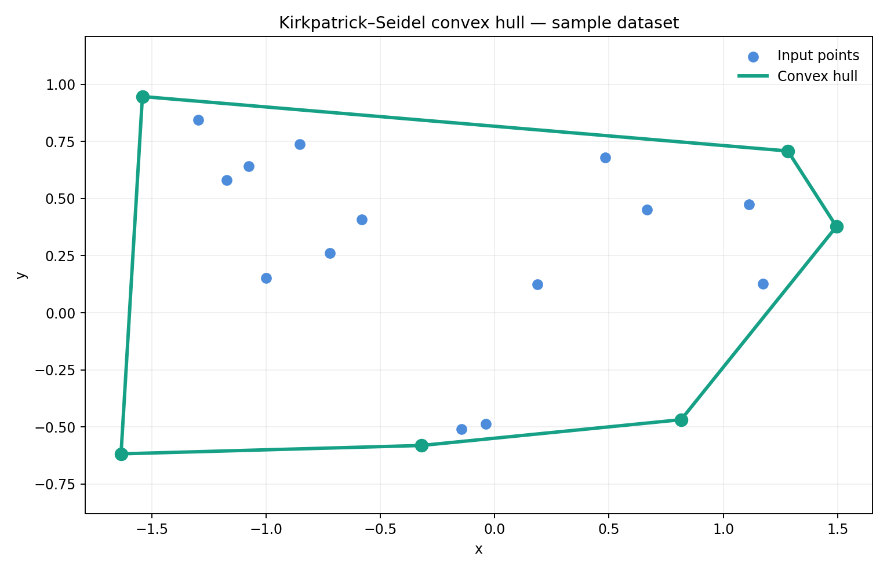

<div align="center">

# Kirkpatrick–Seidel Convex Hull

**Computational Geometry · Wolfram Mathematica**


An implementation of the **Kirkpatrick–Seidel algorithm** for computing a planar convex hull using the *marriage-before-conquest* strategy.



</div>

## Overview

Given a finite collection of planar points, the **convex hull** is the smallest convex set containing all of them. In other words, it is the boundary of the smallest convex polygon enclosing the input.

The Kirkpatrick–Seidel algorithm finds a supporting edge (a **bridge**) across a vertical median, eliminates points that cannot lie on the upper hull, and recursively processes the remaining subsets. A similar construction produces the lower hull.

The original algorithm has an output-sensitive worst-case complexity of **O(n log h)**, where `n` is the number of input points and `h` is the number of convex-hull vertices. This complexity bound belongs to the published algorithm; it has **not** been established for this particular Mathematica implementation.

## Implementation

| Function | Purpose |
| --- | --- |
| `QuickSelect` | Select an order statistic using partitioning |
| `Bridge` | Identify the supporting bridge across a vertical line |
| `ConnectPoints` | Recursively connect the upper-hull segments |
| `UpperHull` | Build the upper convex hull |
| `LowerHull` | Build the lower convex hull using reflection |
| `Convexhull` | Combine both hull chains |
| `Main` | Import data, compute a hull, report timing and plot |

## Project structure

```text
.
├── README.md
├── notebooks/
│   └── KirkpatrickSeidel.nb
├── data/
│   └── problem1.txt
├── images/
│   └── convex-hull-example.png
└── docs/
    └── algorithm.md
```

## Getting started

1. Clone this repository, or download its ZIP archive.
2. Open [`notebooks/KirkpatrickSeidel.nb`](notebooks/KirkpatrickSeidel.nb) in **Wolfram Mathematica**.
3. Select **Evaluation → Evaluate Notebook** to run the notebook from top to bottom.
4. The notebook automatically reads [`data/problem1.txt`](data/problem1.txt), prints hull coordinates and elapsed time, and draws the resulting polygon.

The sample input has 20 points and produced a **six-vertex hull** in the saved output of the original notebook. The illustration above was recreated from those saved coordinates.

### Input data format

The first line contains the number of points. Each remaining line contains `x y` coordinates separated by whitespace:

```text
4
0 0
1 0
1 1
0 1
```

To use a different dataset, replace `data/problem1.txt`, retaining its first-line count. A relative file path is configured in the notebook, so no Windows-specific paths are needed.

## Notes and limitations

- This is an **educational implementation**, not a formally verified or benchmarked geometry library.
- The notebook was reorganized from the original source and has **not been executed in a Wolfram kernel in this environment**.
- Special cases such as coincident points, collinear inputs and multiple points sharing the same x-coordinate require additional testing. In particular, do not assume the `Bridge` fallback handles every degeneracy correctly.
- The saved example image is a visual reference, not independent proof of general correctness.
- See [algorithm notes](docs/algorithm.md) for details and suggested test cases.

## Reference

D. G. Kirkpatrick and R. Seidel (1986). *The Ultimate Planar Convex Hull Algorithm?* **SIAM Journal on Computing**, 15(1), 287–299. [DOI: 10.1137/0215021](https://doi.org/10.1137/0215021).

## Author

[Sultan Gayazov (@Shtrudel7)](https://github.com/Shtrudel7)
